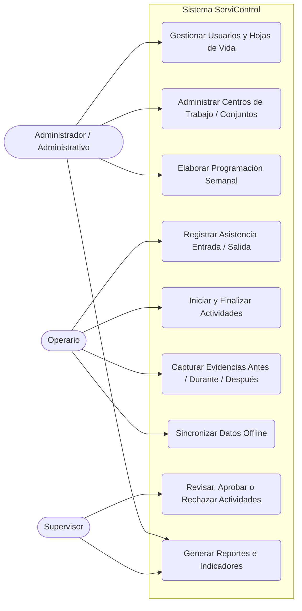
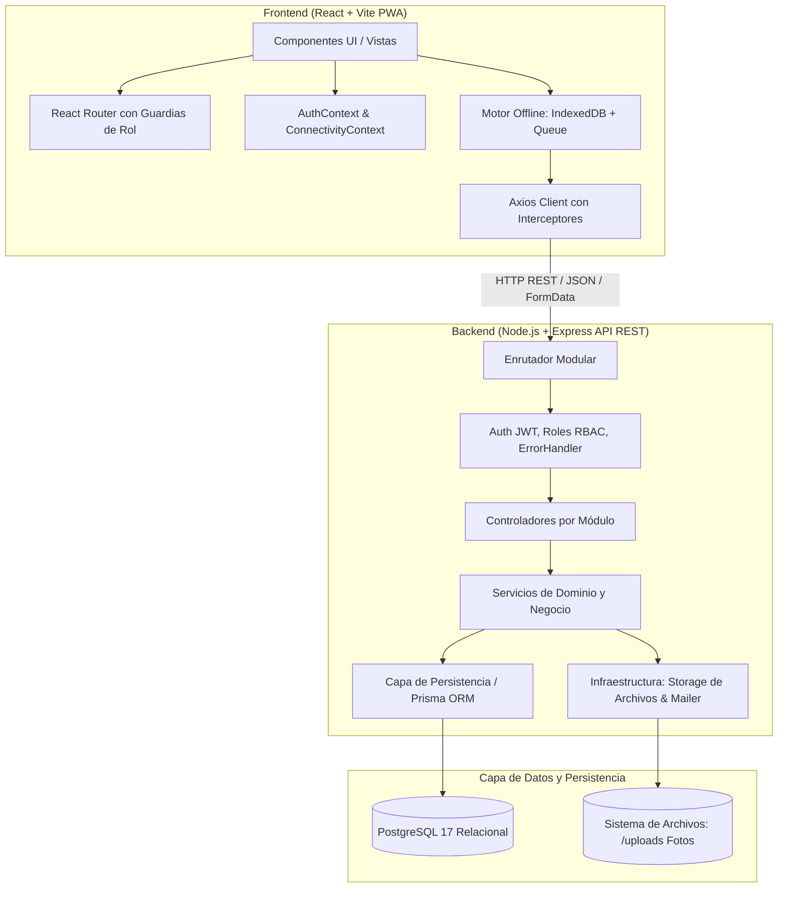
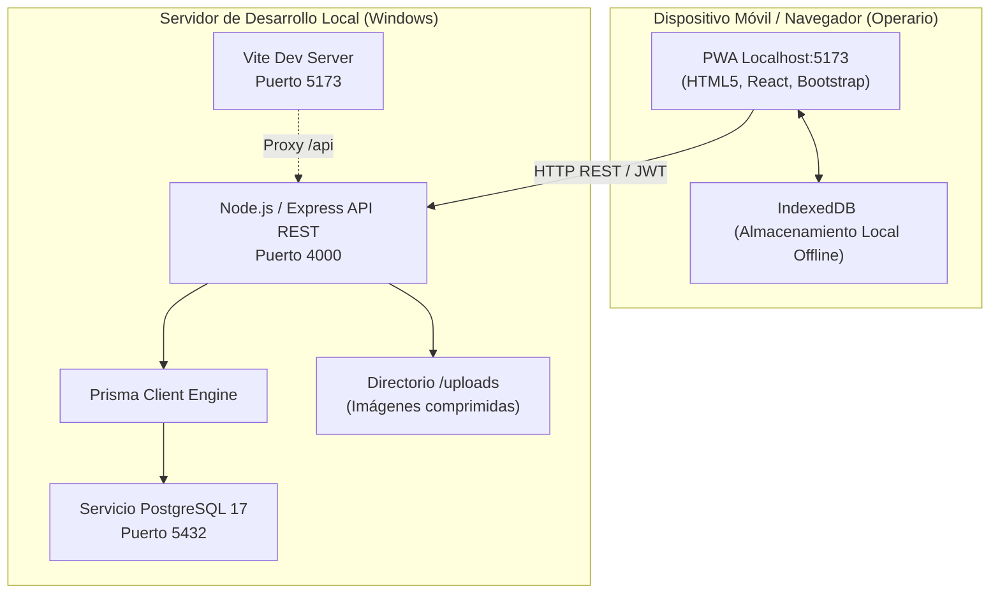

# DOCUMENTO DE ARQUITECTURA DE SOFTWARE - SERVICONTROL
**Sistema de Gestión y Seguimiento de Servicios Locativos**  
*Taller Práctico de Ingeniería de Software Orientada a Objetos*

---

## 1. Atributos de Calidad Priorizados

| Atributo | Métrica / Requisito | Justificación en el Problema |
|---|---|---|
| **Disponibilidad / Resiliencia (Offline)** | Funcionamiento 100% operativo sin internet en dispositivos de operarios. RTO = 0 para captura de datos en campo. | Los operarios laboran en sótanos, zonas comunes o conjuntos sin cobertura ni Wi-Fi. |
| **Tiempo de Respuesta** | $\le 200\text{ ms}$ en API REST local/servidor; operaciones locales en IndexedDB $\le 30\text{ ms}$. | Celulares de gama media/baja deben tener una experiencia ágil y fluida. |
| **Seguridad y Cifrado** | Cifrado unidireccional de contraseñas con `bcrypt` (cost factor 10), autenticación sin estado con tokens JWT de 8 horas y autorización RBAC en dos capas. | Protección de datos laborales, evidencias y roles diferenciados (Admin, Supervisor, Operario). |
| **Integridad de Datos** | Cero pérdida de evidencias fotográficas; operaciones de sincronización idempotentes con UUID v4. | La información pendiente nunca debe destruirse ni duplicarse ante fallos de conexión. |

---

## 2. Limitaciones Técnicas y de Negocio

- **Limitación de Red:** Ausencia total de conectividad de datos móviles en los operarios y restricción de acceso al Wi-Fi de los conjuntos cerrados.
- **Limitación de Hardware:** Los operarios no cuentan con equipos empresariales; utilizan sus propios teléfonos móviles personales de gama baja o media.
- **Limitación de Almacenamiento:** No almacenar binarios de imágenes directamente en PostgreSQL (se almacenan en sistema de archivos y metadatos en BD relacional).
- **Limitación Operativa:** Turnos estrictos de lunes a viernes con asignación semanal previa y validación obligatoria contra solapamiento de horarios.

---

## 3. Diagrama de Casos de Uso del Sistema

---

## 4. Descripción de Escenarios Críticos (Top 3 de Mayor Impacto)

1. **Escenario Crítico 1: Jornada Completa Desconectada (Offline-First Resiliency)**
   - *Estímulo:* El operario ingresa a un conjunto residencial sin señal celular y ejecuta 3 actividades.
   - *Impacto:* La aplicación móvil web debe registrar la entrada, inicio, fotos comprimidas (antes, durante, después) y finalización en **IndexedDB**, garantizando persistencia local íntegra sin fallos por falta de red.
2. **Escenario Crítico 2: Sincronización Idempotente y Concurrente por Lotes**
   - *Estímulo:* 150 operarios recuperan conectividad simultáneamente al salir de los conjuntos residenciales a las 5:00 PM y sus dispositivos inician sincronización automática.
   - *Impacto:* El endpoint de sincronización del backend debe procesar lotes con identificadores UUID generados en el cliente, evitando duplicidad de asistencias o evidencias fotográficas aunque se reintente la petición por microcortes.
3. **Escenario Crítico 3: Validación Anti-Solapamiento en la Programación Semanal**
   - *Estímulo:* El administrador asigna múltiples actividades a un operario en diferentes conjuntos residenciales durante la misma semana.
   - *Impacto:* La capa de servicios debe evaluar los intervalos $[h_{inicio}, h_{fin}]$ para asegurar que ningún operario tenga doble asignación simultánea, garantizando la consistencia del horario laboral.

---

## 5. Estilo Arquitectónico: Monolito Modular por Capas

### Justificación de la Elección
Se selecciona el estilo **Monolito Modular Organizado por Capas** por las siguientes razones:
- **Alta Cohesión y Bajo Acoplamiento:** Cada módulo funcional (`auth`, `programacion`, `asistencia`, `ejecucion`, `evidencias`) encapsula su controlador, servicio y repositorio, evitando el "código espagueti".
- **Simplicidad de Despliegue y Mantenimiento:** Para el volumen de la empresa (aproximadamente 200 usuarios totales) y la sustentación académica, una arquitectura de microservicios añadiría sobrecostos de red, latencia y complejidad distribuida innecesaria.
- **Cumplimiento de Principios SOLID:**
  - **SRP (Single Responsibility):** El controlador solo atiende HTTP, el servicio orquesta reglas de negocio y el repositorio encapsula el acceso a datos.
  - **DIP (Dependency Inversion):** Los servicios dependen de abstracciones y repositorios, no de implementaciones directas de bajo nivel.

---

## 6. Diagrama de Componentes / Paquetes

---

## 7. Diagrama Entidad-Relación (BD Relacional en PostgreSQL)

---

## 8. Justificación de PostgreSQL
- **Garantía ACID Estricta:** La programación semanal, los registros de asistencia legal y el estado de los trabajos requieren consistencia inmediata y transacciones atómicas.
- **Integridad Referencial Fuerte:** Claves foráneas que impiden estados inválidos (ej. una evidencia huérfana sin actividad).
- **Soporte de Índices Compuestos:** Búsquedas rápidas en rangos de fechas y estados de sincronización.
- **Tipos de Datos Nativos y Extensiones:** UUIDs nativos, Timestamps con zona horaria (`timestamptz`) y tipos `enum` seguros.

---

## 9. Diagrama de Despliegue Local

---

## 10. Tecnologías Utilizadas

- **Frontend:** React 18, Vite 6, Bootstrap 5, Bootstrap Icons, React Router v7, Axios, `idb` (IndexedDB).
- **Backend:** Node.js 22 LTS, Express 5, CORS, Multer (archivos), BcryptJS, JSON Web Tokens (JWT), Zod.
- **Base de Datos & ORM:** PostgreSQL 17, Prisma ORM.
- **Herramientas de Entorno:** VS Code, Git, pgAdmin 4.

---

## 11. Decisiones Arquitectónicas Críticas

| # | Problema Encontrado | Opciones Evaluadas | Opción Seleccionada | Justificación Técnica |
|---|---|---|---|---|
| **D1** | Operarios sin cobertura celular ni Wi-Fi en conjuntos cerrados. | 1. Exigir plan de datos empresarial. 2. Aplicación móvil nativa en Java/Kotlin. 3. PWA con Service Worker e IndexedDB. | **PWA con IndexedDB** | Los operarios usan sus propios celulares (gama baja/media). PWA no requiere instalación por tienda, es multiplataforma y IndexedDB soporta almacenamiento local de fotos y cola de sincronización. |
| **D2** | Almacenamiento de evidencias fotográficas en alta resolución. | 1. Guardar Base64/BYTEA en PostgreSQL. 2. Sistema de archivos local + metadatos en BD. 3. Cloud Storage (AWS S3). | **Sistema de archivos local + Metadatos en PostgreSQL** | Guardar binarios en BD degrada severamente el rendimiento de las consultas y satura los backups. El almacenamiento en disco con compresión cliente optimiza espacio y PostgreSQL solo guarda URLs y metadatos. |
| **D3** | Prevención de duplicados en la sincronización tras cortes de red. | 1. Auto-incrementales del servidor. 2. Identificadores UUID v4 generados en el cliente con upsert. | **UUID v4 cliente + Sincronización Idempotente** | Al generarse el UUID en el dispositivo desconectado, reintentar una sincronización fallida no crea duplicados en el servidor gracias a la restricción `UNIQUE (uuid)`. |

