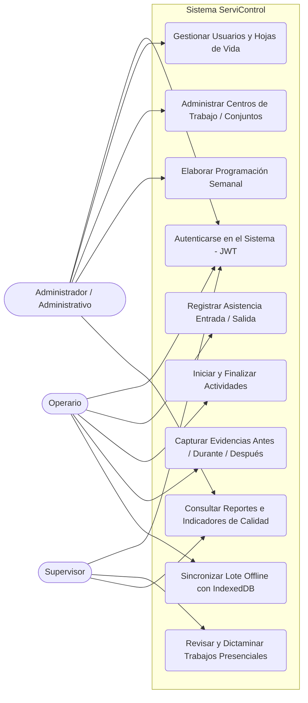
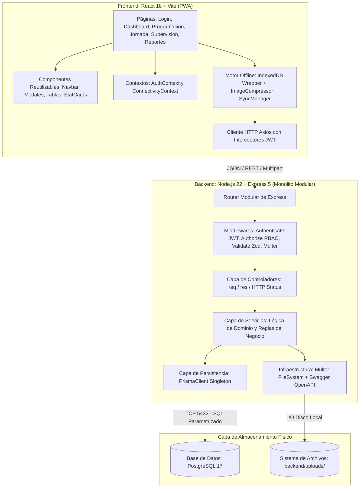
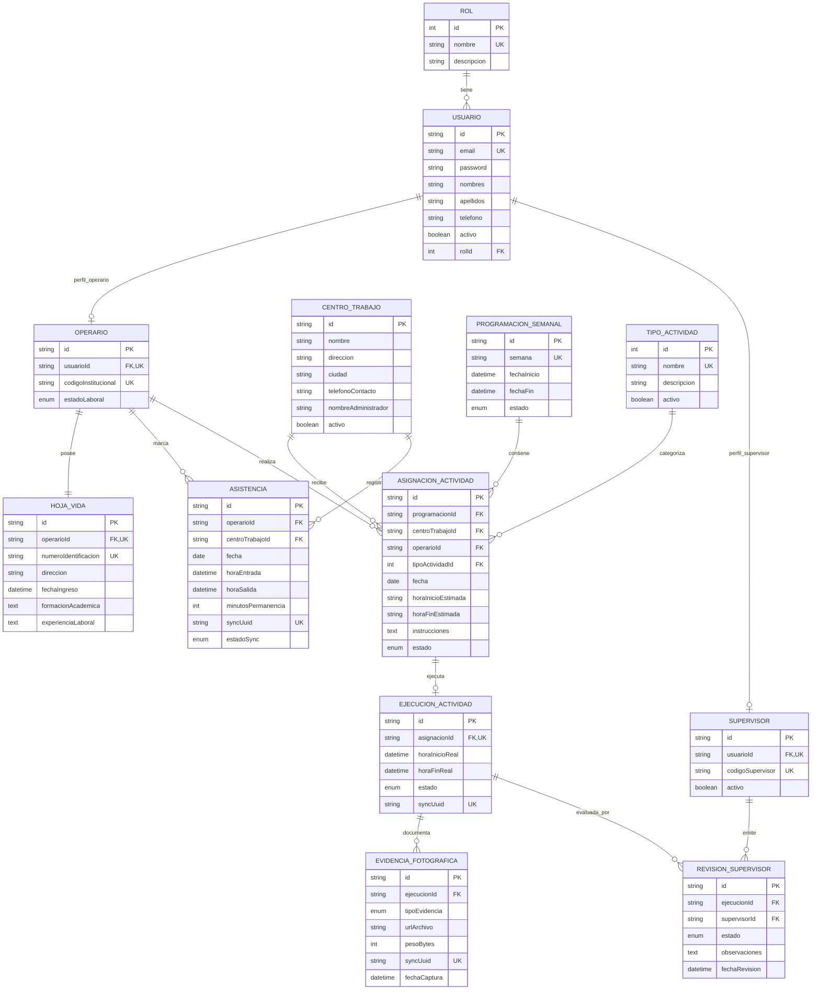
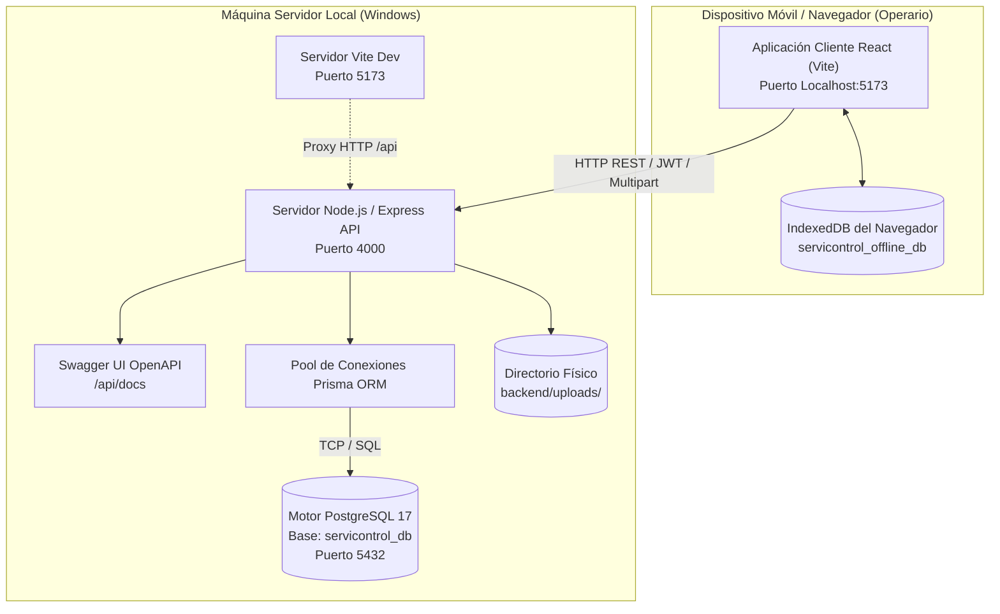

# DOCUMENTO DE ARQUITECTURA DE SOFTWARE - SERVICONTROL
**Sistema de Gestión y Seguimiento de Servicios Locativos para Conjuntos Residenciales**  
*Taller Práctico de Ingeniería de Software Orientada a Objetos*

---

## 1. Atributos de Calidad Priorizados

| Atributo de Calidad | Requisito / Métrica | Justificación en el Problema de Negocio |
|---|---|---|
| **Disponibilidad y Resiliencia (Offline-First)** | RTO = 0 para captura de datos en campo. La app debe continuar operativa sin acceso a internet o Wi-Fi. | Los operarios laboran en sótanos, zonas comunes o conjuntos donde no hay señal celular ni acceso a redes locales. |
| **Tiempo de Respuesta (Performance)** | $\le 200\text{ ms}$ en la API REST local; $\le 30\text{ ms}$ en operaciones locales de IndexedDB y compresión de fotos $\le 1.5\text{ s}$. | Los operarios utilizan teléfonos móviles personales de gama media/baja; la interfaz debe ser ágil y ligera. |
| **Seguridad, Autenticación y Cifrado** | Cifrado unidireccional de contraseñas con `bcrypt` (factor de costo 10), tokens JWT con expiración de 8 horas y autorización RBAC en dos capas. | Protección de datos laborales, prevención de accesos no autorizados y diferenciación estricta de roles. |
| **Integridad y No Repudio de Datos** | Cero pérdida de evidencias fotográficas; operaciones de sincronización idempotentes garantizadas por `syncUuid` (UUID v4). | La información pendiente de sincronización nunca debe destruirse ni duplicarse ante fallos o microcortes de red. |

---

## 2. Limitaciones Técnicas y de Negocio

- **Limitación de Conectividad (Red):** Los operarios frecuentemente carecen de plan de datos móviles y los conjuntos residenciales de propiedad horizontal prohíben el uso de sus redes Wi-Fi a contratistas.
- **Limitación de Dispositivos (Hardware):** La empresa no suministra terminales móviles a los 150 operarios; ellos usan sus propios teléfonos inteligentes personales de gama media/baja. La solución debe evitar el uso intensivo de CPU o memoria RAM.
- **Limitación de Almacenamiento (Base de Datos):** Prohibición estricta de almacenar archivos binarios de imágenes (BYTEA/BLOB) directamente en PostgreSQL para no degradar el rendimiento del motor. Las fotos se almacenan en sistema de archivos (`/uploads`) y sus metadatos en la base de datos relacional.
- **Limitación Operativa y Legal:** Control estricto de turnos laborales (lunes a viernes), cálculo automático de minutos de permanencia y prevención absoluta de cruces de horarios.

---

## 3. Diagrama de Casos de Uso del Sistema

---

## 4. Descripción de Escenarios Críticos (Top 3 de Mayor Impacto)

### Escenario Crítico 1: Jornada de Campo 100% Desconectada (Offline-First Resiliency)
- **Fuente del estímulo:** Operario en zona sótano/parqueadero del conjunto sin cobertura celular.
- **Estímulo:** El operario marca su entrada, inicia el mantenimiento de piscina, toma las 3 fotografías (antes, durante y después), finaliza la labor y marca su salida.
- **Entorno:** Dispositivo móvil con `navigator.onLine = false`.
- **Respuesta de la arquitectura:** La capa de presentación delega en `offlineQueue.js`, el cual comprime las fotografías en el cliente mediante Canvas API y persiste de manera inmediata las transacciones en **IndexedDB** con identificadores UUID v4.
- **Medida de respuesta:** Cero errores en pantalla, estado visual en amarillo *"Modo Desconectado"* y almacenamiento seguro local sin depender del servidor.

### Escenario Crítico 2: Sincronización Idempotente y Concurrente por Lotes al Fin de Jornada
- **Fuente del estímulo:** Múltiples operarios saliendo simultáneamente de los conjuntos a las 5:00 PM y recuperando conectividad.
- **Estímulo:** El evento `window.addEventListener('online')` se dispara y activa `syncManager.js`.
- **Entorno:** Conexión intermitente con posibles microcortes durante la subida.
- **Respuesta de la arquitectura:** El cliente despacha el lote a `/api/sincronizacion/lote`. El backend procesa las asistencias y ejecuciones utilizando `syncUuid UNIQUE`. Si una petición se interrumpe y se reintenta, PostgreSQL no duplica registros gracias a la cláusula de unicidad. Solo cuando el servidor responde HTTP 200, el cliente elimina los registros de IndexedDB.
- **Medida de respuesta:** Cero registros duplicados, cero datos perdidos.

### Escenario Crítico 3: Validación Anti-Solapamiento en la Programación Semanal
- **Fuente del estímulo:** Administrador intentando programar labores a los operarios.
- **Estímulo:** El administrador asigna una labor a un operario en el "Conjunto Alameda" de 10:00 a 14:00, cuando el operario ya tenía asignada otra labor en "Torres del Parque" de 08:00 a 12:00 el mismo día.
- **Entorno:** Panel administrativo web concurrente.
- **Respuesta de la arquitectura:** La capa de negocio (`ProgramacionService`) evalúa la colisión de intervalos temporales:
  $$horaInicio < existeFin \quad \land \quad horaFin > existeInicio$$
  Al detectar la intersección, aborta la operación y lanza una excepción `AppError` con código **HTTP 409 (Conflict)**, retornando el detalle de la labor causante.
- **Medida de respuesta:** Imposibilidad matemática de generar conflictos de agenda en la base de datos.

---

## 5. Estilo Arquitectónico: Monolito Modular Organizado por Capas

### Justificación de la Elección
Se seleccionó una arquitectura de **Monolito Modular por Capas** frente a otras alternativas (como Microservicios o Arquitectura Hexagonal pura) por los siguientes fundamentos:

1. **Alta Cohesión y Bajo Acoplamiento:** Cada módulo funcional (`auth`, `usuarios`, `centros-trabajo`, `operarios`, `programacion`, `asistencia`, `ejecucion`, `evidencias`, `supervision`, `reportes`) encapsula sus rutas, controladores, servicios y validadores.
2. **Cumplimiento de Principios SOLID:**
   - **SRP (Single Responsibility Principle):** Cada capa cumple un rol unívoco:
     - *Controlador:* Maneja la petición HTTP, códigos de estado y respuestas JSON.
     - *Servicio:* Orquesta la lógica de negocio, validaciones y cálculos.
     - *Prisma ORM:* Encapsula el acceso a datos y sentencias SQL parametrizadas.
   - **OCP (Open/Closed Principle):** Para añadir un nuevo tipo de servicio o módulo no es necesario alterar el núcleo del servidor ni modificar esquemas de otros módulos.
   - **LSP (Liskov Substitution Principle):** La clase `AppError` extiende polimórficamente la clase base `Error` de JavaScript, permitiendo que el middleware centralizado trate cualquier excepción de manera uniforme.
   - **ISP (Interface Segregation Principle):** Las rutas exponen contratos específicos por rol (el operario solo consume `/mis-actividades`, el supervisor consume `/supervision`).
   - **DIP (Dependency Inversion Principle):** Los controladores dependen de servicios desacoplados y no de la infraestructura física directa.
3. **Eficiencia en Despliegue:** Para una organización de 200 usuarios y un proyecto académico universitario, desplegar múltiples microservicios introduciría latencias de red, sobrecostos y complejidad distribuida innecesaria. El monolito modular ofrece la misma separación de responsabilidades con un despliegue simple y transacciones ACID nativas.

---

## 6. Diagrama de Componentes o Paquetes

---

## 7. Diagrama Entidad-Relación (Base de Datos Relacional PostgreSQL)

---

## 8. Justificación de la Base de Datos Escogida (PostgreSQL 17)

1. **Garantía Estricta de Transacciones ACID:**
   - La programación de horarios y las firmas de asistencia laboral tienen implicaciones legales y operativas. Se requiere consistencia inmediata, aislamiento de transacciones y atomicidad (soportadas nativamente por PostgreSQL).
2. **Integridad Referencial Fuerte mediante Foreign Keys:**
   - Previene estados inconsistentes o registros huérfanos (por ejemplo, una evidencia fotográfica huérfana sin actividad asociada, o una asistencia sin operario válido).
3. **Manejo Nativo de Tipos de Datos y UUIDs:**
   - Permite claves primarias `UUID` y tipos enumerados nativos (`RolNombre`, `EstadoActividad`, `TipoEvidenciaFoto`, `EstadoRevision`) que garantizan la integridad de dominio directamente en el motor.
4. **Protección contra Inyección SQL mediante Prisma ORM:**
   - Todas las consultas ejecutadas por Prisma utilizan sentencias preparadas y parametrizadas, neutralizando cualquier riesgo de inyección SQL.

---

## 9. Diagrama de Despliegue Local

---

## 10. Tecnologías Utilizadas

- **Frontend:** React 18, Vite 6, Bootstrap 5, Bootstrap Icons, React Router v7, Axios, `idb` (IndexedDB Wrapper), HTML5 Canvas API (compresión de imágenes).
- **Backend:** Node.js 22 LTS, Express 5, CORS, Multer (almacenamiento de archivos en disco), BcryptJS (cifrado de contraseñas), JSON Web Tokens (`jsonwebtoken`), Zod (validación de esquemas y DTOs), `swagger-ui-express` y `swagger-jsdoc` (OpenAPI 3.0).
- **Base de Datos & ORM:** PostgreSQL 17.4, Prisma ORM 6.
- **Herramientas de Entorno y Control de Versiones:** VS Code, Git, pgAdmin 4.

---

## 11. Explicación de las Decisiones Críticas

| # | Problema Encontrado | Opciones Evaluadas | Opción Seleccionada | Justificación Técnica |
|---|---|---|---|---|
| **D1** | Los operarios no cuentan con acceso a internet ni Wi-Fi durante su jornada laboral en los conjuntos residenciales. | 1. Obligar a la empresa a contratar planes de datos móviles. 2. Aplicación móvil nativa en Java/Kotlin. 3. PWA con IndexedDB y sincronización en segundo plano. | **PWA con IndexedDB local** | Los operarios usan sus propios celulares (gama baja/media). Desarrollar una PWA con IndexedDB no requiere publicación en tiendas de apps, consume un mínimo de memoria y permite guardar localmente asistencia, inicio/fin y fotos antes de sincronizar al salir del conjunto. |
| **D2** | El almacenamiento de fotografías de alta resolución tomadas con celulares satura la base de datos y la memoria del móvil. | 1. Convertir fotos a Base64 y guardarlas en PostgreSQL (`BYTEA`). 2. Sistema de archivos local (`/uploads`) + metadatos en PostgreSQL con compresión en cliente. 3. Almacenamiento en nube (Amazon S3 / Cloudinary). | **Compresión en Canvas API + Sistema de archivos local con metadatos en PostgreSQL** | Guardar binarios en base de datos degrada drásticamente los tiempos de consulta y multiplica el tamaño de los backups. Al comprimir en el cliente con Canvas API reducimos las fotos de 4MB a ~250KB y solo guardamos rutas y metadatos en PostgreSQL, cumpliendo la restricción académica. |
| **D3** | Riesgo de duplicación de asistencias y evidencias cuando 150 operarios recuperan conectividad y reintentan sincronizar. | 1. IDs autoincrementales asignados por el servidor. 2. Identificadores UUID v4 generados en el dispositivo móvil con validación de idempotencia en backend. | **UUID v4 en cliente + Sincronización Idempotente en Backend** | Al generarse el UUID en el móvil desconectado, si la sincronización sufre un microcorte y se reintenta, el backend detecta el `syncUuid UNIQUE` y no duplica el registro, respondiendo confirmación limpia al cliente. |
| **D4** | Conflicto de asignaciones múltiples a un mismo operario en horarios solapados durante la semana. | 1. Dejar la validación al criterio humano del administrador. 2. Validación visual únicamente en frontend. 3. Algoritmo de validación de intervalos temporales en la capa de servicios del backend. | **Algoritmo de Intersección de Intervalos en Servicio Backend** | Siguiendo el principio de no confiar únicamente en el frontend, la regla de negocio $A_{inicio} < B_{fin} \land A_{fin} > B_{inicio}$ se ejecuta en `ProgramacionService`. Si hay conflicto, rechaza con HTTP 409 protegiendo la integridad horaria. |
| **D5** | Supervisión sin justificación en casos de rechazo de trabajos. | 1. Permitir rechazar sin observaciones. 2. Validar motivo obligatorio en backend y frontend. | **Validación de Rechazo con Observación Obligatoria (Zod + Backend)** | La calidad del servicio exige que si una labor de jardinería o piscina es rechazada, el operario conozca con exactitud qué corregir. La capa de validación rechaza con HTTP 400 cualquier rechazo con menos de 10 caracteres de observación. |
